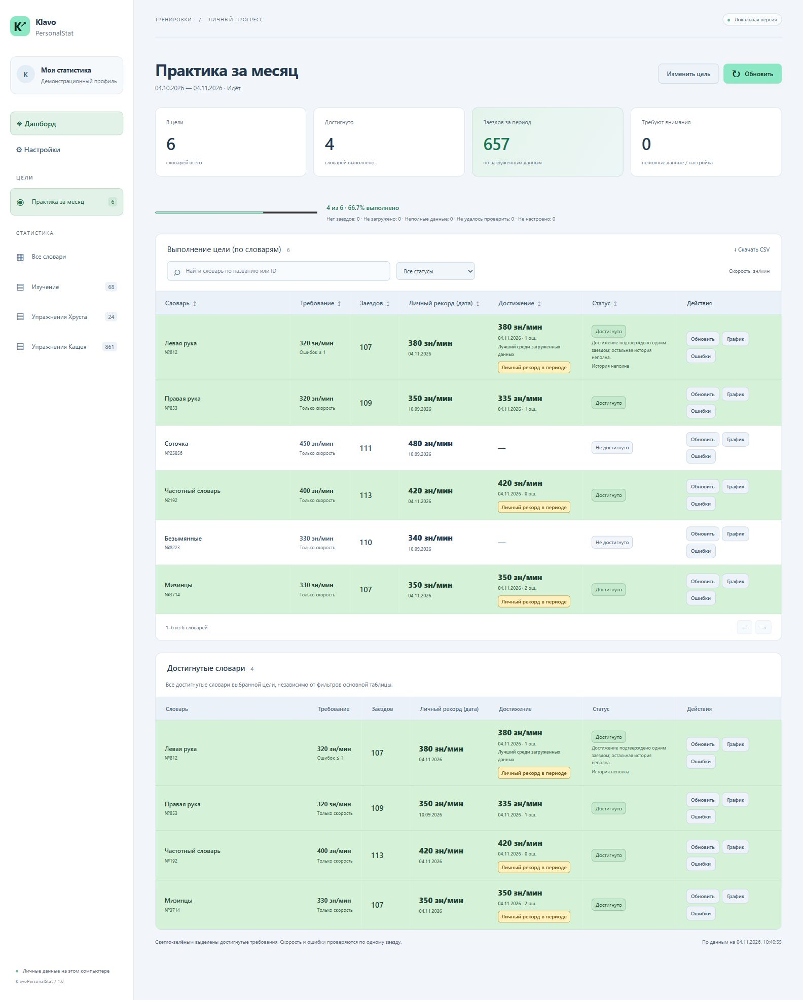
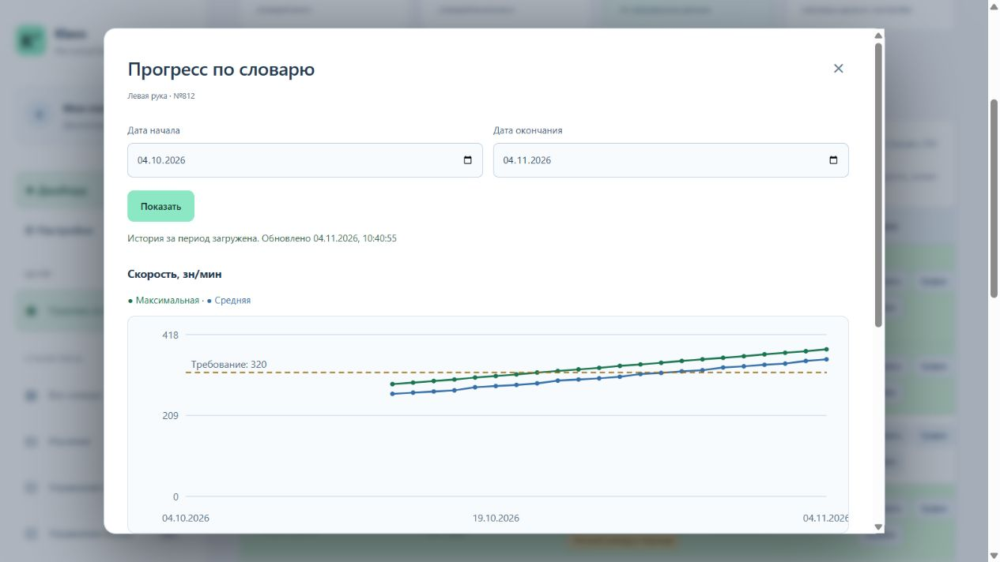
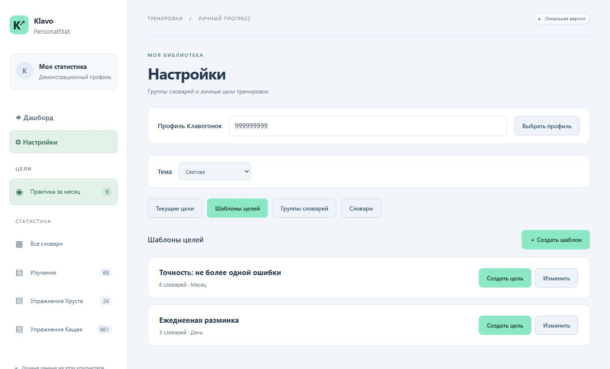

# KlavoPersonalStat

Личная статистика и достижение целей на [klavogonki.ru](https://klavogonki.ru/): тренировки по словарям, контроль скорости и ошибок, графики прогресса и личные рекорды.

Программа работает локально: Python запускает небольшой сервер, а интерфейс открывается в браузере. Внешние библиотеки, Node.js и отдельный сервер базы данных для запуска не нужны.

## Что умеет программа

- Создавать цели по выбранным словарям с индивидуальными требованиями к скорости и ошибкам.
- Учитывать результаты за скользящий или фиксированный период и показывать процент выполнения.
- Показывать личные рекорды, число завершённых заездов и достигнутые словари.
- Строить графики максимальной и средней скорости и количества заездов по дням.
- Сохранять шаблоны целей, группы словарей и краткие названия словарей.
- Запускать тренировку по словарю в новой вкладке, обновлять отдельные строки и выгружать результаты в CSV.
- Использовать светлую или тёмную тему и хранить данные нескольких профилей раздельно.

### Выполнение цели

Требования, личные рекорды, достижения и количество заездов видны в одной таблице. Выполненные требования выделяются зелёным, ниже показаны достигнутые словари.

Кнопка «Столбцы» позволяет настроить обе таблицы; выбор сохраняется в браузере. Дата личного рекорда вынесена в отдельный столбец и по умолчанию скрыта. Статус «Достигнуто N раз» считает подходящие заезды за период по скорости и допустимому числу ошибок. При неполной истории число относится к загруженным заездам; если выполнение подтверждено только дневным максимумом, показывается «Достигнуто» без количества.

В строке доступны кнопки тренировки, загрузки данных и меню «Ещё»: настройка требования в цели, страница словаря, открытая игра с ожиданием 10 секунд и недельные рекорды.



### Графики прогресса

Динамика максимальной и средней скорости, линия требования цели и количество заездов помогают оценить результаты тренировок. Период можно изменить, значения доступны также в таблице.



### Шаблоны целей

Повторно используйте наборы словарей и индивидуальные требования: новая цель получает независимую копию настроек шаблона.



На скриншотах показаны демонстрационные данные. Они не загружаются при установке программы.

## Установка и запуск

### Windows

1. Установите **Python 3.10 или новее** с [официального сайта](https://www.python.org/downloads/windows/). При наличии опции **Add Python to PATH** включите её. Проверить установку можно командой `py -3 --version` или `python --version`.
2. [Скачайте проект ZIP-архивом](https://github.com/uranic2/KlavoPersonalStat/archive/refs/heads/main.zip) и **распакуйте его** в отдельную папку. Не запускайте программу внутри архива.
3. Дважды нажмите **start.cmd**. Откроется браузер с адресом `http://127.0.0.1:8765/`. Оставьте окно программы открытым на время работы.
4. При первом запуске укажите **ID своего профиля** или вставьте ссылку на профиль с Клавогонок, например `https://klavogonki.ru/u/#/123456/stats/`. Число `123456` в примере замените своим ID. Нажмите **Начать работу**. Пароль от сайта не требуется.
5. Выберите нужную группу словарей в разделе **Статистика** и нажмите **Обновить**. Для сетевого обновления нужен интернет; первое получение истории может занять время.
6. Откройте **Настройки → Текущие цели → Создать цель**, задайте период, словари и требования. Сохраните цель и при необходимости обновите её историю.

При следующем запуске программа использует сохранённый профиль и локальные данные. Имя профиля с сайта появится после обновления результатов. Другой профиль можно выбрать в **Настройках**, введя его ID или ссылку и нажав **Выбрать профиль**; существующие результаты при этом сохраняются отдельно.

Чтобы остановить программу, нажмите **Ctrl+C** в её окне. Закрытие вкладки браузера не останавливает сервер.

### Запуск из командной строки

Откройте терминал в распакованной папке проекта:

```text
python server.py
```

На macOS и Linux обычно используется `python3 server.py`.

Полезные варианты:

```text
python server.py --profile 123456
python server.py --port 8766
python server.py --no-browser
python server.py --sync
```

- `--profile 123456` — создать или выбрать свой профиль и запомнить его. Замените число своим ID.
- `--port 8766` — использовать другой порт, если стандартный занят; откройте `http://127.0.0.1:8766/`.
- `--no-browser` — запустить сервер без автоматического открытия браузера.
- `--sync` — обновить все группы выбранного профиля и завершить работу. При первом запуске используйте `--profile СВОЙ_ID --sync`.

В Windows параметры можно передать и через `start.cmd`, например `start.cmd --port 8766`. Установка пакетов через pip не нужна.

## Цели и периоды

У каждого словаря можно задать один из режимов:

- **Только скорость** — результат не ниже заданного порога.
- **Скорость и ошибки** — скорость не ниже порога и не более заданного числа ошибок **в том же заезде**. Нулевой допуск допустим; неизвестное число ошибок не считается нулём.

Словари добавляются из встроенных или своих групп, по ID, ссылкам или через поиск. Требования можно настроить индивидуально либо применить ко всем. Цель хранит собственный состав: последующее изменение группы не меняет уже созданную цель.

Доступны скользящие периоды: день, неделя, месяц, три месяца, полгода и год; либо фиксированные даты начала и окончания. Обе граничные даты включаются, расчёты выполняются по Москве. Скользящий период сдвигается со временем; завершённый фиксированный период сохраняет свои даты. Будущие заезды не запрашиваются.

Личный рекорд показывается за всё время. В колонке **Достижение** показана максимальная известная скорость за период цели независимо от выполнения требований по скорости и ошибкам. При равной скорости выбирается самая ранняя дата; если за этот день известен конкретный заезд, показываются его данные. Подтверждённый личный рекорд в периоде отмечается отдельной меткой. Выполнение требований и число достижений рассчитываются отдельно в колонке **Статус**.

Колонка **Заездов** показывает число завершённых заездов за период. При неполной истории значения отмечаются как полученные по загруженным данным. Поиск, сортировка и страницы не меняют общий процент выполнения и состав CSV. Таблица **Достигнутые словари** не зависит от фильтров основной таблицы.

## Настройки и действия со словарями

- **Текущие цели** — самостоятельные цели, в том числе достигнутые, завершённые и ещё не начавшиеся. Кнопка **Изменить цель** доступна также на дашборде.
- **Шаблоны целей** — создание, изменение и удаление наборов требований; существующую цель можно сохранить как шаблон. Изменение шаблона не меняет цели, созданные из него. Для новой цели с фиксированным периодом даты задаются заново.
- **Группы словарей** — свои подборки из ID и ссылок; можно импортировать первое сообщение темы форума Клавогонок. Встроенные группы «Изучение», «Упражнения Хруста» и «Упражнения Кащея» доступны сразу и не содержат результатов пользователей.
- **Словари** — необязательные краткие имена, общие для данного словаря во всех целях и группах одного профиля. Обновление с сайта их не перезаписывает.
- **Тема** — светлая или тёмная; выбор сохраняется в браузере.

В строке словаря группы доступны **Обновить** и **График**. Построчное обновление получает результаты только этого словаря за период текущего экрана. После успешной загрузки над таблицей остаётся сообщение со всеми обработанными словарями и фактическим периодом запросов. Используются краткие имена текущего профиля или полные названия и номера словарей; отсутствие заездов не исключает словарь из списка. График при открытии читает локальные данные; недостающую историю можно загрузить явно. Пропуски не превращаются в нулевую скорость, полные и неполные данные различаются. Для графика можно выбрать до десяти лет.

Нажатие на название словаря открывает запуск тренировки в новой вкладке. Текущее состояние дашборда сохраняется. CSV содержит весь состав цели или выбранной группы, полные и краткие названия и результаты.

## Ограничения данных Клавогонок

Используется внутренний API сайта, который может измениться или ограничить доступ. Дневные агрегаты доступны отдельно от подробной истории. Максимум скорости и минимум ошибок из разных заездов не объединяются в вымышленное достижение.

**Проверено 06.11.2026 для профиля с Premium:** подробная история с `grouping=none` доступна при запросе за один день. Ответ содержит число ошибок, но не исходный текст и позиции ошибок, необходимые для достоверного списка слов. Действие «Ошибки» убрано из интерфейса; создание словаря для отработки ошибок отменено.

Просмотр сохранённой статистики, работа с целями и шаблонами доступны без интернета. При ошибке сбора предыдущие успешные результаты сохраняются.

## Где хранятся данные

**База SQLite не поставляется с проектом и не публикуется на GitHub.** При первом запуске автоматически создаётся папка `data/` и файл `data/stats.sqlite3`. Новая установка содержит общий каталог словарей, но не содержит чужих профилей, целей, рекордов или истории. Автоматического импорта старых личных отчётов нет.

Выбранный профиль хранится в `data/settings.json`. Цели, шаблоны, краткие имена и результаты профилей находятся в SQLite. Файлы `data/`, резервные копии, журналы и локальные отчёты исключены из Git через `.gitignore`. Ваши существующие локальные данные при публикации проекта не очищаются.

Перед изменением схемы приложение создаёт согласованную резервную копию в `data/backups/` через SQLite backup API с учётом WAL. Для ручного резервирования остановите программу и скопируйте папку `data/`. При обновлении приложения заменяйте файлы программы, сохраняя свою папку `data/`.

Сервер слушает только `127.0.0.1`; исходники и файлы базы не раздаются через HTTP. Используйте один экземпляр приложения с одной базой.

## Проверки для разработчиков

```text
python -m unittest discover -s tests -v
node --test tests/frontend.test.cjs
```

Node.js нужен только для проверок интерфейсной логики. Проверки покрывают чистый первый запуск, выбор профиля, миграции, разделение данных пользователей, цели и шаблоны, периоды, графики, обновление одного словаря, темы и обработку неполных данных.

Основные файлы: `server.py` — локальный сервер; `core.py` — каталог, SQLite и API; `profiles.py` — профили и выбор пользователя; `goals.py` — цели и шаблоны; `history.py` — история, графики и анализ; `static/` — интерфейс без внешних библиотек.
